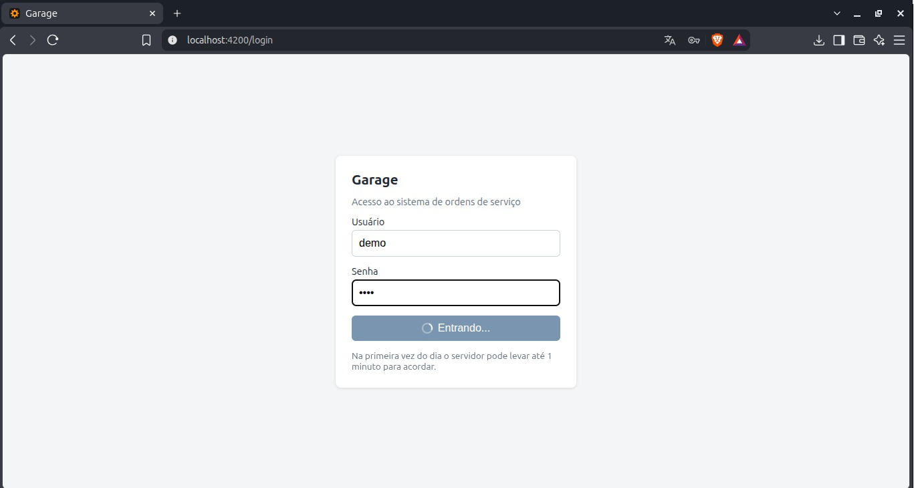
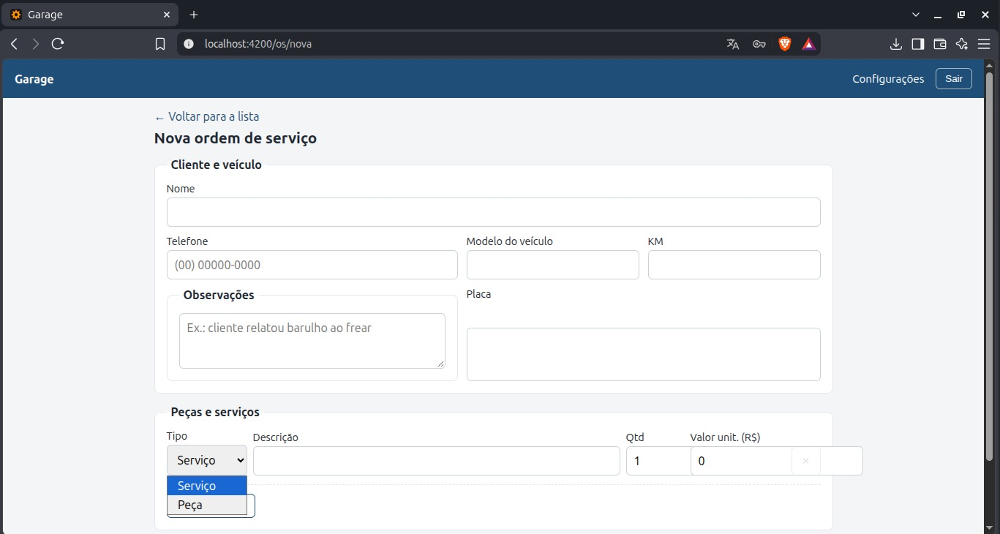
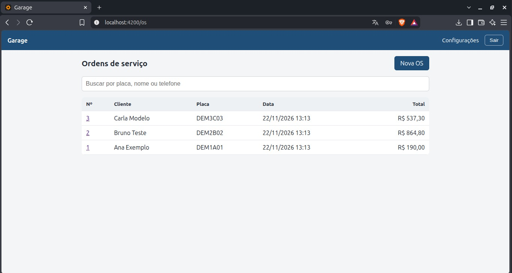
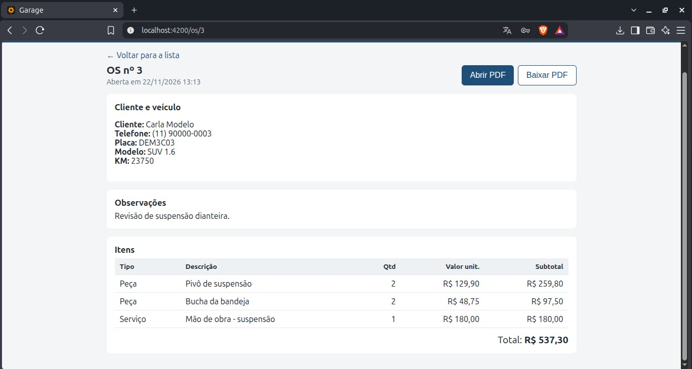
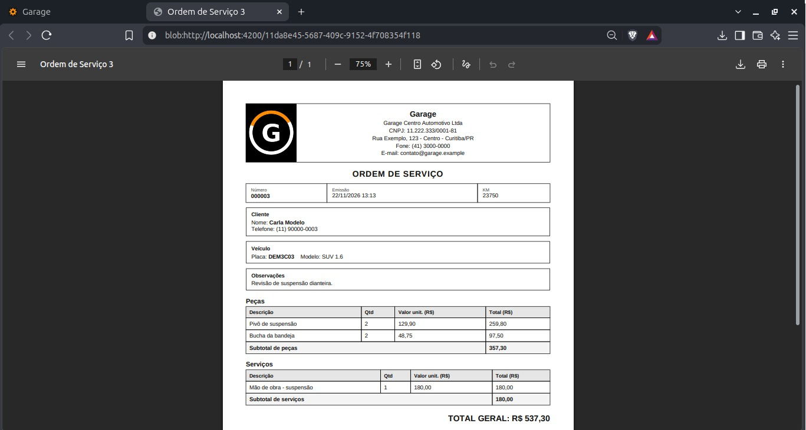
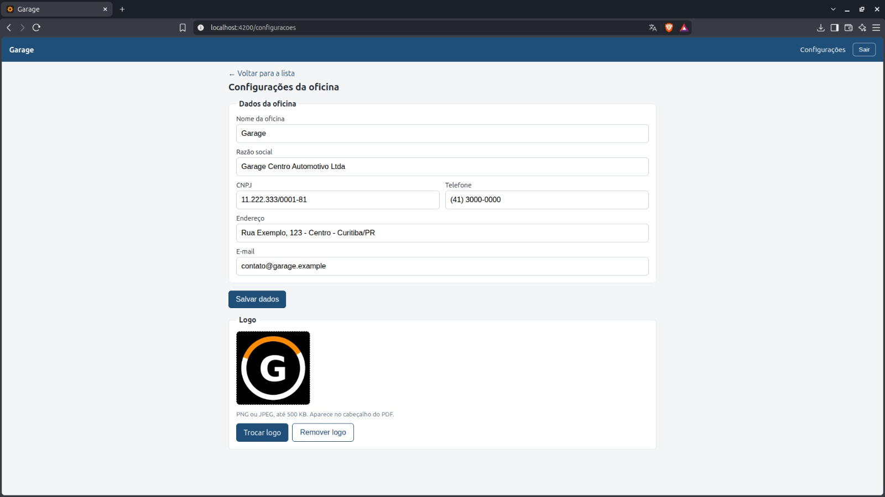

# Garage — Ordens de Serviço


Sistema web para oficinas emitirem e imprimirem **Ordens de Serviço em PDF**:
cadastro rápido de cliente e veículo, itens de peças e serviços, total calculado
no servidor e PDF pronto para impressão.

> Todos os dados deste repositório e das capturas de tela são **fictícios**.

## Capturas de tela


| Login| Nova OS |
|---|---|
|  |  |

| Lista | Detalhe |
|---|---|
|  |  |

| PDF gerado | Configurações da oficina |
|---|---|
|  |  |

## Demo

- App: https://garage-web-zeta.vercel.app/login
- Usuário: `demo` · Senha: `1234`

> A API roda em plano gratuito e "dorme" após 15 minutos sem uso: o primeiro
> acesso pode levar até 1 minuto. Todos os dados são fictícios, e qualquer
> visitante pode alterá-los.

## Funcionalidades

- Login com JWT (senha com BCrypt, sessão sem estado)
- Cadastro de OS com cliente, veículo (placa, modelo, KM), observações e itens
- Itens dinâmicos de **peças** e **serviços**, com subtotais
- **Total calculado apenas no back-end** (`BigDecimal`, arredondamento HALF_UP)
- Cliente reaproveitado pelo telefone (guardado só com dígitos)
- Busca por placa, nome ou telefone
- PDF da OS gerado no servidor (Thymeleaf + OpenHTMLtoPDF)
- Oficina configurável: nome, razão social, CNPJ (validado), endereço, contato e logo

## Tecnologias

- **Java 21**, **Spring Boot 4** (Web MVC, Data JPA, Security, Validation)
- **PostgreSQL** com migrações **Flyway**
- **Thymeleaf + OpenHTMLtoPDF** para o PDF
- **JUnit 5, AssertJ e Mockito** para testes; **GitHub Actions** para CI
- Front-end em Angular: [garage-web](https://github.com/SEU_USUARIO/garage-web)

## Decisões técnicas

- **Dinheiro com `BigDecimal`, nunca `double`.** O valor unitário aceita no
  máximo 2 casas (`@Digits`), para o total gravado sempre bater com a soma dos
  itens. Esse bug foi encontrado e coberto por um teste.
- **O cliente nunca envia o total.** O DTO nem tem esse campo; o servidor calcula.
- **Arquitetura em camadas:** controller → service → repository, com DTOs na
  borda (nenhuma entidade é exposta na API).
- **Schema versionado com Flyway** e `ddl-auto=validate`: o Hibernate não altera o banco.
- **Upload de logo validado pelos bytes** (PNG/JPEG, até 500 KB), sem confiar no
  nome nem no `Content-Type`.
- **Sem dados reais no repositório.** Segredos vêm de variáveis de ambiente.

## Como rodar localmente

Requisitos: JDK 21+ e PostgreSQL.

```bash
# 1. criar o banco
createdb oficina_demo

# 2. variáveis de ambiente
export DB_USER=oficina
export DB_PASSWORD=...           # senha do seu usuário no PostgreSQL
export DB_URL=jdbc:postgresql://localhost:5432/oficina_demo
export JWT_SECRET=...            # gere com: openssl rand -base64 48
export ADMIN_USERNAME=demo
export ADMIN_PASSWORD=...        # senha do primeiro usuário
export SPRING_PROFILES_ACTIVE=demo   # carrega dados fictícios

# 3. subir
./mvnw spring-boot:run
```

A API sobe em `http://localhost:8080`. O perfil `demo` cria a oficina
"Garage" e 3 OS de exemplo, e **recusa rodar** em um banco cujo nome não
contenha `demo`.

### Variáveis de ambiente

| Variável | Obrigatória | Descrição |
|---|---|---|
| `DB_USER`, `DB_PASSWORD` | sim | Credenciais do PostgreSQL |
| `DB_URL` | não | Padrão: `jdbc:postgresql://localhost:5432/oficina` |
| `JWT_SECRET` | sim | Segredo de assinatura do token |
| `ADMIN_USERNAME`, `ADMIN_PASSWORD` | sim | Usuário criado na primeira execução |
| `CORS_ORIGINS` | não | Padrão: `http://localhost:4200` |
| `SPRING_PROFILES_ACTIVE` | não | `demo` para dados fictícios |

## Testes

```bash
./mvnw test
```

Cobrem o cálculo do total (incluindo casos de arredondamento), a validação de
valores monetários e as regras de criação de OS (reuso de cliente, normalização
de telefone e placa). Rodam a cada push no GitHub Actions.

## Endpoints principais

| Método | Rota | Descrição |
|---|---|---|
| POST | `/api/auth/login` | Autenticação, devolve o token |
| POST | `/api/os` | Cria uma OS |
| GET | `/api/os?busca=` | Lista/busca OS |
| GET | `/api/os/{id}` | Detalhe da OS |
| GET | `/api/os/{id}/pdf` | PDF da OS |
| GET/PUT | `/api/configuracao` | Dados da oficina |
| PUT/DELETE | `/api/configuracao/logo` | Logo da oficina |

Todas, exceto o login, exigem `Authorization: Bearer <token>`.

## Roadmap

- Contas a pagar e a receber
- Controle de estoque
- Perfis de usuário e campo "emitido por"
- Testes de integração com Testcontainers